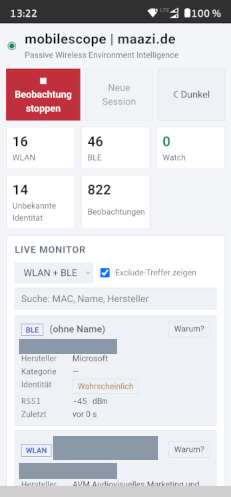
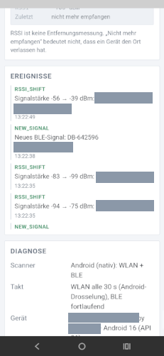
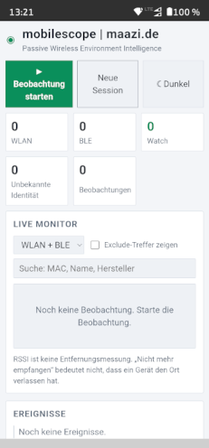
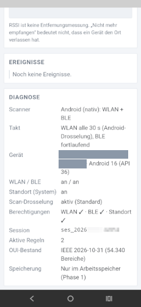

# mobilescope

**Passive Wireless Environment Intelligence** – a local-first measurement tool that observes, classifies and documents the visible WLAN and Bluetooth LE environment, and always shows _why_ it reached a conclusion.

🇬🇧 English · [🇩🇪 Deutsch](#deutsch)

<!-- SCREENSHOT (active state): replace docs/images/screenshot-active.png with a capture of a running observation. -->




> **Status:** early development (v1.0). The Android app scans real WLAN and BLE signals. The web app runs a demo scanner (browsers cannot scan WLAN) and is meant for analysis. Not yet published as a release.

---

## What it is

mobilescope is built for technicians, engineers and scientists who need a **traceable view of the radio environment** in the lab or in field trials – not a "find devices around me" toy.

Core ideas:

- **Observation ≠ interpretation.** Every classification carries evidence, a confidence level and explicit _limitations_. There are no fake percentages.
- **Local first.** Scanning, classification, rules and storage happen on the device. Nothing is uploaded.
- **Passive observation.** Only received metadata is evaluated. No connections to foreign devices, no injection, no payload capture.
- **Privacy by design.** No personal identification, no location stored, exports will be controllable.
- **Platform aware.** Android, iOS, Windows and Linux differ a lot in what they allow. mobilescope states what it really observed and what the OS limited.

## What it shows

| Information             | What it means                                                  | What it does **not** mean                              |
| ----------------------- | -------------------------------------------------------------- | ------------------------------------------------------ |
| Address (MAC/BSSID)     | The address that was received                                  | A stable device identity (addresses can be randomized) |
| OUI / manufacturer      | The registered address block of a manufacturer (IEEE registry) | The actual model, owner or purpose of the device       |
| Category / family       | A _possible_ hardware class                                    | A confirmed device type                                |
| Identity state          | `Known` · `Probable` · `Unknown`                               | –                                                      |
| RSSI                    | Received signal strength                                       | A distance                                             |
| "Not received any more" | The signal was not received in the expected interval           | That the device has left                               |

Example: a Cradlepoint OUI may yield _manufacturer: Cradlepoint, category: network equipment (possible cellular router)_ – but never "vehicle of authority X". That would need independent evidence.

Tap **"Warum?" ("Why?")** on any row to see the evidence records, their sources and their limitations.

## Features

| Area                                                                        | Status                                           |
| --------------------------------------------------------------------------- | ------------------------------------------------ |
| Live monitor (WLAN + BLE), filter and search                                | ✅ implemented                                   |
| Native Android scanner (Kotlin plugin, permissions, device diagnostics)     | ✅ implemented                                   |
| IEEE OUI classification (MA-L / MA-M / MA-S, 54k+ ranges)                   | ✅ implemented                                   |
| Evidence engine with limitations ("Why?" dialog)                            | ✅ implemented                                   |
| Watch / Mute / Exclude rule engine, conflict handling, event log            | ✅ engine implemented, ⏳ rule editor UI planned |
| Light and dark theme                                                        | ✅ implemented                                   |
| Local session storage (IndexedDB, autosave every 30 s)                      | ✅ implemented                                   |
| CSV / JSON export (optional address truncation, names omitted), JSON import | ✅ implemented                                   |
| Foreground service for long runs with screen off                            | ⏳ planned                                       |
| AI debrief (opt-in, anonymized package)                                     | 🔬 research                                      |
| Windows / Linux scanners                                                    | 🔬 later                                         |

<!-- SCREENSHOT (inactive state): replace docs/images/screenshot-inactive.png with a capture before "Start observation" is pressed. -->
<p align="center">
  
  
  <br><em>Idle state: no observation running yet.</em>
</p>

## Architecture

```
packages/core    platform-independent logic (data model, address types, OUI/evidence
                 classification, rules, event engine, mock scanner) – fully unit-tested
packages/data    versioned reference data: IEEE OUI registry + build script
apps/web         React + Vite web app (live monitor, evidence dialog, diagnostics, themes)
apps/android     Capacitor shell + Kotlin plugin "RfScanner" (WLAN scan, BLE scan, permissions)
```

The web UI is shared between browser and Android. The only platform-specific piece is the scanner: in the APK the native `RfScanner` plugin feeds real observations into the same core that the web app uses with its demo scanner. The UI is currently in German.

## Getting started

Requirements: **Node.js LTS**. For Android additionally the Android SDK (platform 36) and **JDK 21** (Temurin recommended – Android Studio's bundled JDK may be too new for the Gradle wrapper).

```bash
git clone https://github.com/ATOMICMBAG/mobilescope-v1.git
cd mobilescope-v1
npm install
npm run dev          # web app on http://localhost:5173 (demo scanner)
npm test             # core unit tests (Vitest)
npm run typecheck
npm run build
```

### Android (debug APK)

```powershell
powershell -File scripts/build-apk.ps1
```

Result: `apps/android/android/app/build/outputs/apk/debug/app-debug.apk`, installable via `adb install -r`.
Target: Android 13+ (API 33, `minSdk 33`).

Permissions requested: _Nearby devices_ (WLAN), _Bluetooth scan_ and _Location_. Android requires the location permission for radio scans; **mobilescope does not read or store your position.** The system location switch must be on.

Android limits WLAN scans (foreground: about 4 per 2 minutes), so the WLAN list refreshes every ~30 s while BLE reports continuously. The diagnostics panel shows the throttle state and the age of results.

## Data sources

OUI data comes from the public registry of the [IEEE Registration Authority](https://standards-oui.ieee.org/) (MA-L, MA-M, MA-S). Update it with:

```bash
node packages/data/scripts/build-oui.mjs <ma-l.csv> <ma-m.csv> <ma-s.csv> YYYY-MM-DD
```

Bluetooth company identifiers are currently a small seed list; the full Bluetooth SIG list is planned.

## Responsible use

mobilescope is a measurement and documentation tool. It evaluates radio metadata that devices broadcast openly (WLAN beacons, BLE advertisements).

**What it does not do:** it connects to no foreign device, decrypts nothing, injects nothing and captures no payload. It stores no location. Everything stays on your device unless you export it yourself.

**Please keep it that way:**

- Observing is not identifying. Do not use it to track, profile or target people. MAC addresses and BLE identifiers can be personal data; the "Watch" rules are meant for equipment you are responsible for (lab, field test, your own network), not for following individuals.
- Respect the laws and rules that apply where you measure, and measure only where you are allowed to.
- Before sharing an export, use the options to shorten addresses and omit names.
- Classifications are hints with documented limits, not proof.

**Legal note (not legal advice):** To our understanding, a passive receiver of openly broadcast metadata is a dual-use tool of the same kind as common WLAN analyzer apps; liability for misuse lies with whoever misuses or modifies it. The software is provided "as is" without warranty (see the license). If you plan to use it commercially or in a sensitive setting, get advice for your specific case.

## License

Licensed under the [Apache License 2.0](LICENSE). It includes a disclaimer of warranty and liability. The IEEE OUI data in `packages/data` comes from the [IEEE Registration Authority](https://standards-oui.ieee.org/) and is subject to their terms.

---

<a id="deutsch"></a>

# 🇩🇪 Deutsch

[🇬🇧 English](#mobilescope)

**mobilescope** ist ein lokal arbeitendes Messwerkzeug, das die sichtbare WLAN- und Bluetooth-LE-Umgebung beobachtet, klassifiziert und dokumentiert – und immer zeigt, **warum** es zu einer Einschätzung kommt.

<!-- Bild (aktiver Zustand) steht oben im englischen Teil; docs/images/screenshot-active.png ersetzen. -->

> **Stand:** frühe Entwicklung (v1.0). Die Android-App scannt echte WLAN- und BLE-Signale. Die Webapp nutzt einen Demo-Scanner (Browser können kein WLAN scannen) und dient der Auswertung. Noch kein Release.

## Was es ist

mobilescope richtet sich an Techniker, Ingenieure und Wissenschaftler, die im Labor und im Feldversuch eine **nachvollziehbare Sicht auf die Funkumgebung** brauchen – kein Spielzeug zum „Geräte finden".

Leitgedanken:

- **Beobachtung ≠ Interpretation.** Jede Einstufung hat Evidenz, ein Vertrauensniveau und ausdrückliche _Einschränkungen_. Keine Pseudo-Prozentwerte.
- **Local First.** Scan, Klassifizierung, Regeln und Speicherung laufen auf dem Gerät. Es wird nichts hochgeladen.
- **Passive Beobachtung.** Ausgewertet werden nur empfangene Metadaten. Keine Verbindung zu fremden Geräten, keine Injection, kein Mitschneiden von Nutzdaten.
- **Privacy by Design.** Keine Personenidentifikation, keine gespeicherte Position, Exporte sollen kontrollierbar sein.
- **Plattformbewusst.** Android, iOS, Windows und Linux erlauben sehr Unterschiedliches. mobilescope benennt, was tatsächlich beobachtet wurde und was das Betriebssystem eingeschränkt hat.

## Was angezeigt wird

| Information            | Bedeutung                                                      | Bedeutet **nicht**                                           |
| ---------------------- | -------------------------------------------------------------- | ------------------------------------------------------------ |
| Adresse (MAC/BSSID)    | Die empfangene Adresse                                         | Eine stabile Geräteidentität (Adressen können zufällig sein) |
| OUI / Hersteller       | Der registrierte Adressblock eines Herstellers (IEEE-Registry) | Modell, Besitzer oder Zweck des Geräts                       |
| Kategorie / Familie    | Eine _mögliche_ Hardwareklasse                                 | Ein bestätigter Gerätetyp                                    |
| Identitätszustand      | `Bekannt` · `Wahrscheinlich` · `Unbekannt`                     | –                                                            |
| RSSI                   | Empfangene Signalstärke                                        | Eine Entfernung                                              |
| „Nicht mehr empfangen" | Das Signal kam im erwarteten Intervall nicht an                | Dass das Gerät weg ist                                       |

Beispiel: Ein Cradlepoint-OUI ergibt _Hersteller: Cradlepoint, Kategorie: Netzwerkhardware (möglicher Mobilfunkrouter)_ – aber nie „Fahrzeug der Behörde X". Dafür wäre unabhängige Evidenz nötig.

Mit **„Warum?"** in jeder Zeile siehst du Evidenzdatensätze, Quellen und Einschränkungen.

## Funktionen

| Bereich                                                                   | Stand                                        |
| ------------------------------------------------------------------------- | -------------------------------------------- |
| Live Monitor (WLAN + BLE), Filter und Suche                               | ✅ umgesetzt                                 |
| Nativer Android-Scanner (Kotlin-Plugin, Berechtigungen, Gerätediagnose)   | ✅ umgesetzt                                 |
| IEEE-OUI-Klassifizierung (MA-L / MA-M / MA-S, über 54.000 Bereiche)       | ✅ umgesetzt                                 |
| Evidenz-Engine mit Einschränkungen („Warum?"-Dialog)                      | ✅ umgesetzt                                 |
| Watch-/Mute-/Exclude-Regeln, Konfliktbehandlung, Ereignisprotokoll        | ✅ Engine umgesetzt, ⏳ Regel-Editor geplant |
| Helles und dunkles Design                                                 | ✅ umgesetzt                                 |
| Lokale Sessionspeicherung (IndexedDB, Autosave alle 30 s)                 | ✅ umgesetzt                                 |
| CSV-/JSON-Export (optional Adressen kürzen, Namen weglassen), JSON-Import | ✅ umgesetzt                                 |
| Foreground-Service für lange Läufe bei ausgeschaltetem Bildschirm         | ⏳ geplant                                   |
| AI Debrief (optional, anonymisiertes Paket)                               | 🔬 Untersuchung                              |
| Windows-/Linux-Scanner                                                    | 🔬 später                                    |

_Ein Bild des inaktiven Zustands steht weiter oben im englischen Teil (`docs/images/screenshot-inactive.png`)._

## Aufbau

```
packages/core    plattformunabhängige Logik (Datenmodell, Adresstypen, OUI-/Evidenz-
                 Klassifizierung, Regeln, Ereignis-Engine, Mock-Scanner) – vollständig getestet
packages/data    versionierte Referenzdaten: IEEE-OUI-Registry + Build-Skript
apps/web         React + Vite Webapp (Live Monitor, Evidenzdialog, Diagnose, Designs)
apps/android     Capacitor-Hülle + Kotlin-Plugin „RfScanner" (WLAN-Scan, BLE-Scan, Berechtigungen)
```

Die Oberfläche ist für Browser und Android dieselbe. Nur der Scanner ist plattformspezifisch: In der APK liefert das native Plugin `RfScanner` echte Beobachtungen in denselben Core, den die Webapp mit ihrem Demo-Scanner nutzt. Die Oberfläche ist derzeit deutschsprachig.

## Loslegen

Voraussetzung: **Node.js LTS**. Für Android zusätzlich Android SDK (Plattform 36) und **JDK 21** (Temurin empfohlen – das in Android Studio mitgelieferte JDK kann für den Gradle-Wrapper zu neu sein).

```bash
git clone https://github.com/ATOMICMBAG/mobilescope-v1.git
cd mobilescope-v1
npm install
npm run dev          # Webapp auf http://localhost:5173 (Demo-Scanner)
npm test             # Core-Tests (Vitest)
npm run typecheck
npm run build
```

### Android (Debug-APK)

```powershell
powershell -File scripts/build-apk.ps1
```

Ergebnis: `apps/android/android/app/build/outputs/apk/debug/app-debug.apk`, installierbar mit `adb install -r`.
Ziel: Android 13+ (API 33, `minSdk 33`).

Angefragte Berechtigungen: _Geräte in der Nähe_ (WLAN), _Bluetooth-Scan_ und _Standort_. Android verlangt die Standortberechtigung für Funkscans; **mobilescope liest und speichert deine Position nicht.** Der System-Standortschalter muss an sein.

Android drosselt WLAN-Scans (Vordergrund: etwa 4 pro 2 Minuten). Die WLAN-Liste aktualisiert sich daher etwa alle 30 s, BLE meldet fortlaufend. Die Diagnose zeigt Drosselungsstatus und Alter der Ergebnisse.

## Datenquellen

Die OUI-Daten stammen aus der öffentlichen Registry der [IEEE Registration Authority](https://standards-oui.ieee.org/) (MA-L, MA-M, MA-S). Aktualisieren mit:

```bash
node packages/data/scripts/build-oui.mjs <ma-l.csv> <ma-m.csv> <ma-s.csv> JJJJ-MM-TT
```

Die Bluetooth-Hersteller-IDs sind derzeit eine kleine Seed-Liste; die vollständige Bluetooth-SIG-Liste ist geplant.

## Verantwortungsvolle Nutzung

mobilescope ist ein Mess- und Dokumentationswerkzeug. Es wertet Funk-Metadaten aus, die Geräte offen aussenden (WLAN-Beacons, BLE-Advertisements).

**Was es nicht tut:** Es verbindet sich mit keinem fremden Gerät, entschlüsselt nichts, sendet nichts und zeichnet keine Inhalte auf. Es speichert keinen Standort. Alles bleibt auf deinem Gerät, solange du nicht selbst exportierst.

**Bitte dabei bleiben:**

- Beobachten ist nicht Identifizieren. Nicht zum Verfolgen, Profilieren oder Ins-Visier-Nehmen von Personen verwenden. MAC-Adressen und BLE-Kennungen können personenbezogene Daten sein; die „Watch“-Regeln sind für Geräte gedacht, für die du verantwortlich bist (Labor, Feldtest, eigenes Netz), nicht um einzelne Menschen zu verfolgen.
- Die am Messort geltenden Gesetze und Regeln beachten und nur dort messen, wo es erlaubt ist.
- Vor dem Weitergeben eines Exports die Optionen zum Kürzen der Adressen und zum Weglassen der Namen nutzen.
- Klassifizierungen sind Hinweise mit dokumentierten Grenzen, kein Beweis.

**Rechtlicher Hinweis (keine Rechtsberatung):** Nach unserem Verständnis ist ein passiver Empfänger offen ausgesendeter Metadaten ein Dual-Use-Werkzeug wie gängige WLAN-Analyzer-Apps; für Missbrauch haftet, wer die Software missbraucht oder verändert. Die Software wird „wie besehen“ ohne Gewährleistung bereitgestellt (siehe Lizenz). Bei kommerzieller Nutzung oder in sensiblem Umfeld bitte den Einzelfall prüfen lassen.

## Lizenz

Lizenziert unter der [Apache License 2.0](LICENSE), inklusive Gewährleistungs- und Haftungsausschluss. Die IEEE-OUI-Daten in `packages/data` stammen von der [IEEE Registration Authority](https://standards-oui.ieee.org/) und unterliegen deren Bedingungen.
